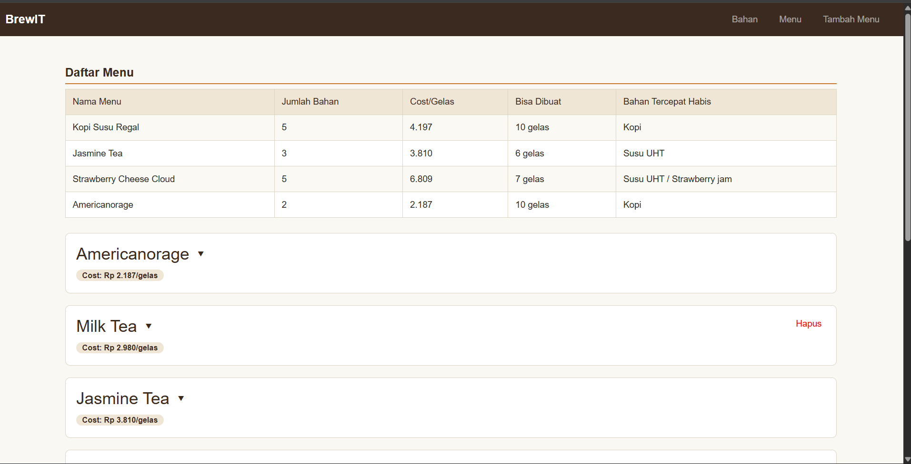
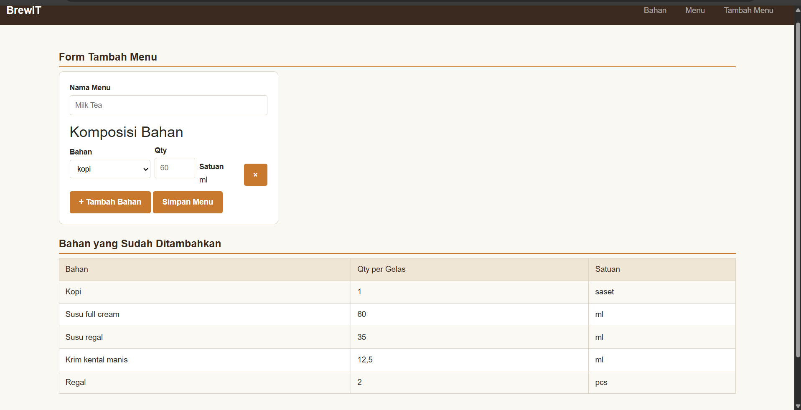

# BrewIT — Frontend (React + Vite)

Aplikasi manajemen bahan & menu BrewIT.

<<<<<<< HEAD
## Menjalankan project

```bash
npm install
npm run dev
```

Buka http://localhost:5173 di browser.

## Struktur

- **Bahan** (entitas utama) — daftar bahan, stok saat ini, estimasi sisa berapa cup
  lagi bisa dibuat berdasarkan pemakaian di semua menu.
- **Menu** — daftar statis 11 menu BrewIT beserta komposisi bahan dan cost per cup.
- **Restock Bahan** — form untuk menambah stok bahan yang sudah ada (bukan bahan
  baru), lengkap dengan riwayat restock.

## Komponen (`src/components/`)

- `Header.jsx` — judul aplikasi + navigasi tab
- `DaftarBahan.jsx` — render daftar bahan + estimasi sisa cup
- `FormRestock.jsx` — controlled form untuk restock bahan
- `RiwayatRestock.jsx` — log riwayat restock
- `DaftarMenu.jsx` / `KartuMenu.jsx` — render daftar menu statis

### Fitur utama
- **Daftar Bahan** — menampilkan seluruh bahan baku beserta stok saat ini dan estimasi
  sisa cup yang bisa dibuat.
- **Daftar Menu** — menampilkan 11 menu BrewIT beserta komposisi bahan dan cost per cup.
- **Restock Bahan** — form untuk menambah stok bahan yang sudah ada, dilengkapi dengan
  riwayat/log setiap transaksi restock yang dilakukan.
=======
### Halaman Menu


### Halaman Tambah Menu

>>>>>>> 0f452cf3eb7c8a9a893c84df6f3301616e3cee4d
